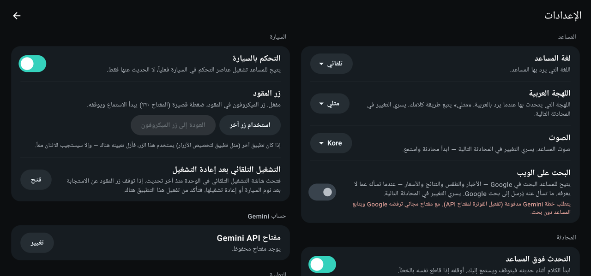
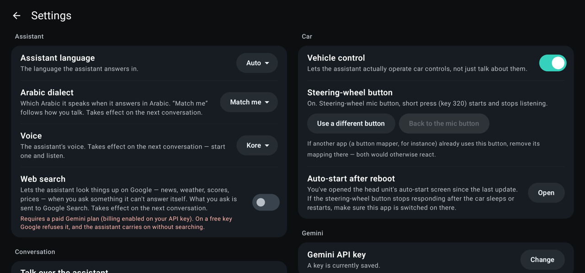

<div dir="rtl">

# BYD Assistant NG

**العربية** · [English](README.md)

مساعد صوتي بدون استخدام اليدين لشاشات سيارات **BYD DiLink**، مبني على واجهة **Gemini Live** من Google. اضغط زر الميكروفون في المقود وتحدّث بشكل طبيعي بالعربية أو الإنجليزية، فيجيبك، ويوجّهك في الملاحة، ويفتح التطبيقات، ويتحكم بمشغّل الوسائط، ويشغّل عناصر الراحة في السيارة — وعند الطلب يتحدث عبر السماعة الخارجية أو يغيّر وضع القيادة.

> **غير رسمي.** هذا مشروع مجتمعي مستقل، لا يرتبط بشركة BYD أو Google ولا تدعمه أو تؤيده. "BYD" و"DiLink" و"Gemini" علامات تجارية تعود لأصحابها. أنت تستخدمه بالكامل على مسؤوليتك الخاصة — راجع [السلامة](#safety).

> هذه ترجمة للملف [README.md](README.md). بقية الوثائق التقنية (مجلد `docs` وغيره) متوفرة بالإنجليزية فقط.

| العربية | English |
| --- | --- |
|  |  |
|  |  |

## ماذا يفعل

- **محادثة طبيعية** مع Gemini Live: تتحدث فيجيبك بالصوت، ويمكنك التحدث فوقه لمقاطعته.
- **زر المقود** يبدأ المحادثة وينهيها (خدمة إمكانية وصول تراقب ذلك الزر وحده).
- **شريط الحالة** على الشاشة يبيّن إن كان الميكروفون يستمع أو المساعد يفكّر أو يتحدث.
- **صوت اللمس**: كل لمسة في التطبيق تُصدر صوت اللمس الخاص بوحدة السيارة، مثل بقية شاشات السيارة.
- **الملاحة** ("خذني إلى …")، و**فتح أي تطبيق مثبّت** بالاسم، و**تشغيل / إيقاف مؤقت / التالي / السابق**.
- **تشغيل شيء داخل تطبيق**: "شغّل أغنية … على Spotify" أو "فيديو عن … على YouTube" أو "شغّل شيئاً هادئاً" فيختار هو. يستخدم طلب التشغيل بالبحث القياسي في Android، فيعمل مع أي تطبيق مثبّت يدعمه، لكنه لا يستطيع الاختيار من الصفحة الرئيسية للتطبيق.
- **تشغيل مكتبتك** (Spotify وYouTube): "شغّل المفضّلة" يشغّل الأغاني التي أعجبتك (الفيديوهات التي أعجبتك في YouTube)، و"شغّل موسيقى من قوائم التشغيل" يشغّل أحدث قائمة لديك، و"شغّل قائمة <الاسم>" (أو "شاهد لاحقاً") يشغّل تلك القائمة.
- **البحث على الويب** عبر Google Search (اختياري؛ يتطلب خطة Gemini مدفوعة — انظر أدناه).
- **التحكم بالسيارة** (مفعّل افتراضياً، ويمكن إيقافه من الإعدادات): المكيف (التشغيل، الحرارة، المروحة، اتجاه الهواء، مصدر الهواء، التهوية، الضاغط، التلقائي، إزالة الضباب)، والنوافذ (فتح/إغلاق أو أي وضع)، وفتحة السقف، والستارة، والصندوق الخلفي، والصوت، وتدفئة وتهوية وتدليك المقاعد، وتدفئة المقود، وإضاءة المقصورة، والثلاجة، ولون وسطوع الإضاءة المحيطة، وطي المرايا تلقائياً وإمالتها عند الرجوع، وكتم الوسائط، وصوت الملاحة، وتركيز الصوت، وكاميرا القيادة ("احفظ هذا المقطع"، "التقط صورة"، وتشغيل الصوت أو إيقافه). القائمة الكاملة مع المعرّفات وما تم التحقق منه في [vehicle-commands.md](docs/byd-internals/vehicle-commands.md) (بالإنجليزية).
- **شاشة الراكب** ("افتح YouTube على شاشة الراكب"، "أغلقه"، "أطفئ شاشة الراكب"): يفتح التطبيقات ويغلقها على شاشة الراكب الأمامي، ويعيدها إلى الرئيسية أو الخلف، ويطفئ إضاءتها الخلفية أو يشغّلها. يتبع مفتاح التحكم بالسيارة نفسه. انظر [passenger-screen.md](docs/byd-internals/passenger-screen.md).
- **جودة الهواء** ("كيف حال الهواء في السيارة؟"): حسّاسات PM2.5 في السيارة، داخل المقصورة وخارجها، مع تقييم السيارة نفسها. للقراءة فقط، وتتبع مفتاح التحكم بالسيارة نفسه.
- **درجة الحرارة الخارجية** ("كم الحرارة في الخارج؟")، تُقرأ من لوحة العدادات؛ وهي تتبع مفتاح التحكم بالسيارة نفسه.
- **ضغط الإطارات** ("كيف حال إطاراتي؟"): يقرأ ضغط كل إطار وتحذيرات السيارة نفسها للضغط المنخفض أو المرتفع وللتسرّب ودرجة الحرارة، ويجيب بالوحدة التي تطلبها. للقراءة فقط، لكنه يتبع مفتاح التحكم بالسيارة نفسه. انظر [tyres.md](docs/byd-internals/tyres.md).
- **الذاكرة**: تحمل الذاكرة *قصيرة المدى* آخر بضع محادثات إلى المحادثة التالية لعشر دقائق، فتنجح المتابعة مثل "افعل الشيء نفسه للراكب"؛ وتحتفظ الذاكرة *طويلة المدى* بما تطلب منه تذكّره ("تذكّر أنني أفضّل المقصورة على ٢١ درجة") أو تضيفه بنفسك، ويمكنك قراءة القائمة وحذف عناصرها أو مسحها من الإعدادات. يمكن إيقاف كل منهما. تُحفظ على الجهاز فقط (انظر [الخصوصية](#privacy)).
- **الانتظار بعد أن تتوقف عن الكلام**: شريط تمرير (من ٠٫٤ إلى ١٫٥ ثانية، والافتراضي ٠٫٨) لمدة انتظار المساعد في الصمت قبل أن يعتبر أنك أنهيت كلامك — الأقصر يجيب أسرع، والأطول يتيح لك التوقف في منتصف الجملة.
- **العربية والإنجليزية**: التطبيق كله مترجم، بما في ذلك التخطيط الكامل من اليمين إلى اليسار. *لغة التطبيق* (الشاشات والرسائل) و*لغة المساعد* (ما يتحدث به) إعدادان منفصلان، وكذلك صوت المساعد، ولهجته عند الرد بالعربية.

### ميزات تجريبية (في إصدارات Beta، ومعطّلة افتراضياً)

تصل هذه الميزات إلى السيارة أبعد من عناصر الراحة، لذلك هي **معطّلة حتى تفعّلها** من *الإعدادات ← الإعدادات المتقدمة ← ميزات تجريبية*، ولكل منها تأكيد خاص. لا تُعرض إلا على سيارة يسمّي إطارها البرمجي الميزة بالطريقة التي تم التأكد منها على سيارة التطوير، ولا تتوفر حالياً إلا في إصدارات Beta. كل التفاصيل عن طريقة عملها في [docs/byd-internals](docs/byd-internals/README.md) (بالإنجليزية).

- **السماعة الخارجية**: "قل للشخص في الخارج إنني قادم" فيخرج رد المساعد من السماعة الخارجية للسيارة (ولا يسمعه أحد في المقصورة)، و"شغّل جرس الباب في الخارج" يشغّل أحد تسعة مؤثرات قصيرة (جرس الباب، رنين، جرس، ثلاث نغمات بيب، منبّه، بوق، صفير، عصافير، قطة). ثلاثة مستويات للصوت (منخفض، متوسط، مرتفع) تضبطها من الإعدادات المتقدمة أو تطلبها بصوتك ("قلها بصوت عالٍ"). التفاصيل: [exterior-speaker.md](docs/byd-internals/exterior-speaker.md).
- **أوضاع القيادة**: "حوّل إلى وضع الرمال" (وكذلك الثلج والطين والجبل والصخور والتلقائي والاقتصادي والرياضي، و"خروج" لمغادرة وضع الطرق الوعرة). يطلب المساعد من السيارة بالطريقة التي تطلبها بها شاشتها نفسها، ثم يخبرك بالوضع الذي تقول السيارة إنها فيه فعلاً — فالقرار للسيارة، ويُرفض الطلب فوق ٨٠ كم/س. أوضاع الخوض (Wade) وWarp والمخصص (Custom) وTraction غير متاحة. ويمكن جمعه مع طلبات أخرى: "وضع الرمال وشغّل بعض الموسيقى". التفاصيل: [drive-modes.md](docs/byd-internals/drive-modes.md).

## المتطلبات

- شاشة BYD DiLink تعمل بنظام مبني على Android 13 (معمارية arm64). طُوّر التحكم بالسيارة واختُبر على سيارة واحدة وإصدار برمجي واحد؛ وقد تختلف الطرازات الأخرى.
- **مفتاح Gemini API** من [Google AI Studio](https://aistudio.google.com/).
- اتصال بالإنترنت للشاشة (مثلاً عبر نقطة اتصال الهاتف).
- **تصحيح ADB** مفعّل في الشاشة. يُستخدم محلياً عبر واجهة loopback لتشغيل خدمة المقود وتشغيل العملية المساعدة التي تتحدث مع خدمات السيارة (أذونات السيارة بمستوى التوقيع، فلا تستطيع عملية تطبيق عادية امتلاكها). إن طلبت الشاشة الموافقة على التصحيح فوافق. انظر [SECURITY.md](SECURITY.md) لما يعنيه ذلك.

## التثبيت

1. نزّل ملف APK من صفحة **Releases** للمشروع وثبّته على الشاشة (من مدير الملفات أو بـ `adb install`). اسمح بالتثبيت من مصادر غير معروفة إن طُلب منك.
2. افتح التطبيق واتبع الإعداد: امنح إذن الميكروفون، وأدخل مفتاح Gemini API، وفعّل زر المقود.
3. في أنظمة BYD، فعّل التطبيق في شاشة **التشغيل التلقائي** في الوحدة (الإعدادات ← *فتح إعدادات التشغيل التلقائي*). بدونها قد يغلق النظام التطبيق عند نوم السيارة، فيتوقف الزر عن العمل.
4. *التحكم بالسيارة* مفعّل افتراضياً؛ أوقفه من الإعدادات إن أردت الحديث فقط. أما الميزات التجريبية في *الإعدادات المتقدمة* فتبقى معطّلة حتى تفعّلها.

### التحديثات

يبحث التطبيق عن إصدار أحدث على GitHub كل ست ساعات تقريباً ويعرض إشعاراً على الشاشة الرئيسية (وإشعاراً هادئاً) عند وجوده. تعرض *الإعدادات ← التحديثات* ما الجديد وتثبّته عند تأكيدك: ينزّل التطبيق الملف ويتحقق أنه هذا التطبيق وموقّع بالمفتاح نفسه وسليم، ثم يثبّته ويعيد تشغيله. افعل ذلك أثناء التوقف، لأن أي محادثة جارية تنتهي. وتبدّل *الإعدادات ← الإعدادات المتقدمة* بين قناة **المستقرة** (إصدارات مختبرة) وقناة **Beta** (أحدث الإصدارات أولاً)، وتوقف التحقق التلقائي.

<a id="privacy"></a>

## الخصوصية

- ما تقوله يُرسل مباشرة إلى Gemini API لإنتاج الرد. لا يُرسل شيء إلى أي جهة أخرى، ولا توجد أي تحليلات أو تتبّع.
- عند تفعيل **البحث على الويب**، تُرسل الأسئلة التي تطرحها أيضاً إلى Google Search.
- يطلب التحقق من التحديثات من GitHub قائمة إصدارات المشروع (لا يُرسل شيء عنك أو عن السيارة). يمكنك إيقافه من *الإعدادات ← الإعدادات المتقدمة*.
- مفتاح API يُخزَّن مشفّراً على الجهاز. وتبقى السجلات على الجهاز حتى تختار مشاركتها — وقد تحتوي ما قلته، فاقرأ السجل قبل إرساله.
- **الذاكرة** تُحفظ على الجهاز (وليس في نسخة احتياطية سحابية). وما تحويه — الحقائق المتذكَّرة، ولعشر دقائق آخر بضع محادثات — يُرسل إلى Gemini ضمن تعليمات المحادثة التالية ليستفيد منه المساعد. أوقف أياً من الذاكرتين أو امسحها من الإعدادات.

<a id="safety"></a>

## السلامة

التحكم بالسيارة يُستخدم بالكامل **على مسؤوليتك**: استخدمه حين يكون ذلك آمناً وتأكد أن السيارة فعلت ما طلبته. أي شيء يؤثر في القيادة — المحرك وناقل الحركة والمحرك الكهربائي والفرامل ومساعدات القيادة والرادار وأنظمة الأمان والطاقة — غير متاح عمداً: هذه الأوامر مستبعدة من قائمة الأوامر، ولا تُعرض على النموذج أبداً، وتُرفض مرة أخرى عند التنفيذ. وتؤكد الأوامر أثرها بقراءة حالة السيارة بعد التنفيذ، وتخبرك بصدق حين لا تطبّقها السيارة.

هناك **استثناءان مقصودان** فقط، كلاهما تجريبي ومعطّل افتراضياً: مفتاح السماعة الخارجية وطلب وضع القيادة. كل منهما معرّف ميزة واحد بقيم ثابتة، خارج قائمة الأوامر، ولا يُستخدم إلا حين يسمّيه الإطار البرمجي للسيارة كما تم التأكد منه، وبعد أن تفعّله وتقبل التحذير. انظر [SECURITY.md](SECURITY.md).

## البحث على الويب

تسمح Google ببحث الاستناد (grounding) على **خطة Gemini مدفوعة** فقط (مع تفعيل الفوترة لمشروع مفتاح API). الإعداد معطّل افتراضياً؛ وعلى مفتاح مجاني ترفض Google الجلسة، فيعيد التطبيق المحاولة دون بحث.

## التوثيق

| | |
| --- | --- |
| [docs/byd-internals](docs/byd-internals/README.md) | كيف يصل التطبيق إلى أجزاء السيارة الداخلية، والمعرّفات والقيم التي وُجدت، ومنهج البحث، وما **لم** ينجح |
| [docs/architecture.md](docs/architecture.md) | كيف بُني التطبيق |
| [tools/probes](tools/probes) | المجسّات للقراءة فقط المستخدمة لاستكشاف الشاشة |
| [CONTRIBUTING.md](CONTRIBUTING.md) | الفروع والإصدارات وإضافة عنصر تحكم والترجمات |
| [SECURITY.md](SECURITY.md) | ما يستطيع التطبيق فعله وما يخزّنه وكيفية الإبلاغ عن ثغرة |

## البناء

يتطلب JDK 21 وAndroid SDK.

<div dir="ltr">

```bash
./gradlew assembleDebug          # debug build (installs next to a release build as ".dev")
./gradlew testDebugUnitTest      # unit tests
./gradlew lintRelease            # lint
```

</div>

إعدادات بناء اختيارية:

- `-Passistant.updateRepo=owner/repo` (أو متغير البيئة `ASSISTANT_UPDATE_REPO`): مستودع GitHub الذي يفحص المحدّث داخل التطبيق إصداراته. بدونه لا يفحص التطبيق التحديثات أبداً ويخفي قسم التحديثات. (النسخة debug لا تحدّث نفسها أبداً.)
- يوضع مفتاح توقيع الإصدار في `app/signing.properties` (غير متتبَّع). لا تضف أبداً ملفات المفاتيح أو كلمات المرور إلى المستودع.

## الفروع

`main` للتطوير؛ والـ commit الذي تبدأ رسالته بـ `beta:` (أو التشغيل اليدوي) ينشر إصداراً تجريبياً منه، والدفع إلى `stable` ينشر إصداراً. انظر [CONTRIBUTING.md](CONTRIBUTING.md).

## هيكل المشروع

| المسار | المحتوى |
| --- | --- |
| `gemini/` | عميل Live API، وآلة حالة المحادثة، وربط الأدوات، ومعالجة الأعطال |
| `audio/` | دخل وخرج الميكروفون والسماعة، وكشف نهاية الكلام، وكشف التحدث فوق المساعد، والسماعة الخارجية |
| `vehicle/` | سجل الأوامر (`resources/vehicle_commands.json`)، وبوابة السلامة، والعملية المساعدة، وأوضاع القيادة |
| `memory/` | الذاكرة قصيرة المدى وطويلة المدى والأدوات التي تحرّرها |
| `service/` | خدمة إمكانية الوصول لزر المقود وشريط الحالة |
| `apps/`، `media/`، `navigation/` | أدوات فتح التطبيقات والوسائط والملاحة |
| `res/values`، `res/values-ar` | النصوص بالإنجليزية والعربية — اختبار وحدة يُبقيهما متطابقين |

## الترخيص

BYD Assistant NG برنامج حر، مرخَّص بموجب **رخصة جنو العمومية، الإصدار 3** ([LICENSE](LICENSE)). يمكنك استخدامه ودراسته وتعديله ومشاركته وفق تلك الشروط؛ وما توزّعه من تعديلات يجب أن يبقى بالرخصة نفسها. يأتي دون أي ضمان — راجع [السلامة](#safety).

</div>
