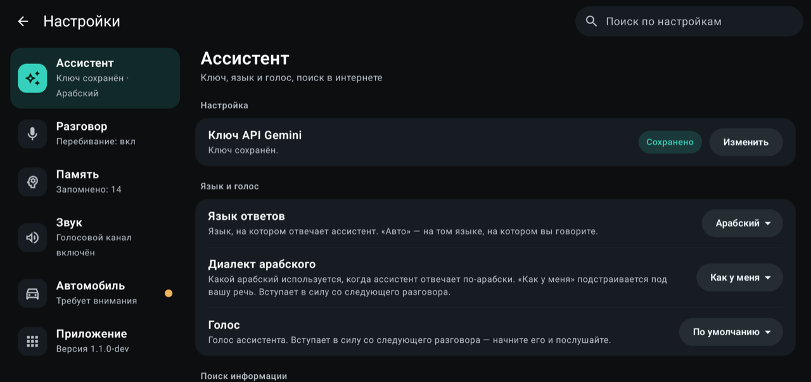

# BYD Assistant NG

[English](README.md) · [العربية](README.ar.md) · [Русский](README.ru.md) · **Polski**

Asystent głosowy bez użycia rąk dla **jednostek głównych BYD DiLink**, zbudowany na API **Gemini Live** od Google. Naciśnij przycisk mikrofonu na kierownicy i mów naturalnie po arabsku, rosyjsku, polsku lub angielsku: asystent odpowie, poprowadzi nawigację, otworzy aplikacje, obsłuży odtwarzacz multimediów, włączy funkcje komfortu w samochodzie i — na życzenie — przemówi przez głośnik zewnętrzny albo zmieni tryb jazdy.

> **Projekt nieoficjalny.** To niezależny projekt społeczności. Nie jest powiązany z BYD ani Google, nie jest przez nie zatwierdzany ani wspierany. „BYD”, „DiLink” i „Gemini” są znakami towarowymi ich właścicieli. Używasz go wyłącznie na własną odpowiedzialność — zobacz [Bezpieczeństwo](#bezpieczeństwo).

> Zaczął jako fork projektu [Assistant](https://github.com/kangrio/Assistant) autorstwa [@kangrio](https://github.com/kangrio) — wielkie dzięki!

> To tłumaczenie pliku [README.md](README.md). Pozostała dokumentacja techniczna (folder `docs` i inne) jest tylko po angielsku.

| Polski (ekrany w angielskiej wersji) | Русский |
| --- | --- |
|  |  |
|  |  |

## Co potrafi

- **Naturalna rozmowa** z Gemini Live: mówisz, asystent odpowiada na głos, a żeby mu przerwać, wystarczy mówić w trakcie jego wypowiedzi.
- **Przycisk na kierownicy** zaczyna i kończy rozmowę (to usługa dostępności, która obserwuje tylko ten jeden klawisz). Własny asystent głosowy samochodu reaguje na ten sam przycisk, więc jedno naciśnięcie może uruchomić oba: w *Ustawieniach* jest przycisk, który go wyłącza (i włącza z powrotem), po potwierdzeniu. Nic nie jest odinstalowywane.
- **Kanał głosowy** (domyślnie włączony, w samochodach, które go mają; *Ustawienia → Dźwięk*): odpowiedzi i sygnały asystenta grają przez własny strumień głosowy samochodu, z osobną głośnością, niezależnie od muzyki. Na czas rozmowy muzyka jest ściszana (domyślnie o połowę; albo własnym ściszaniem samochodu, albo wstrzymana, albo bez zmian), a głośność głosu podąża za hałasem w kabinie i można ją przesunąć suwakiem w górę lub w dół. W samochodzie z głośnikiem w zagłówku kierowcy głos może dobiegać tylko z niego (*Ustawienia → Dźwięk → Głośnik*): na czas rozmowy dźwięk zagłówka jest ustawiany na Interaktywny, a asystent mówi kanałem nawigacji (jego głośność podąża za hałasem w kabinie, a głośność nawigacji jest potem przywracana); po rozmowie dźwięk zagłówka wraca do poprzedniego ustawienia. Jak to działa i dlaczego: [voice-channel.md](docs/byd-internals/voice-channel.md).
- **Pasek stanu** na ekranie pokazuje, czy mikrofon jest włączony, czy asystent myśli, czy mówi.
- **Dźwięk dotyku**: każde dotknięcie w aplikacji klika standardowym dźwiękiem dotyku jednostki głównej, jak na pozostałych ekranach samochodu.
- **Nawigacja** („zawieź mnie do …”), **otwieranie dowolnej zainstalowanej aplikacji** po nazwie, **zamykanie zainstalowanej przez Ciebie aplikacji** („zamknij YouTube”: zatrzymuje się całkowicie; aplikacje samego samochodu i ta aplikacja nigdy nie są zamykane) oraz **odtwarzanie / pauza / następny / poprzedni**.
- **Włączanie czegoś w aplikacji**: „puść <piosenkę> w Spotify”, „film o <temacie> na YouTube” albo „włącz coś nastrojowego” — a asystent sam wybierze. Używa standardowego żądania Androida „odtwórz z wyszukiwania”, więc działa z każdą zainstalowaną aplikacją, która je obsługuje; nie umie wybierać z ekranu głównego aplikacji.
- **Własna biblioteka** (Spotify i YouTube): „puść moje ulubione” uruchamia polubione utwory (polubione filmy na YouTube), „puść muzykę z moich playlist” uruchamia najnowszą playlistę, a „puść moją playlistę <nazwa>” (albo „do obejrzenia później”) uruchamia właśnie tę.
- **Wyszukiwanie w internecie** przez Wyszukiwarkę Google (opcjonalne; wymaga płatnego planu Gemini — patrz niżej).
- **Sterowanie samochodem** (domyślnie włączone; wyłączysz je w Ustawieniach): klimatyzacja (włączanie, temperatura, nawiew, kierunek nawiewu, źródło powietrza, wentylacja, sprężarka, tryb auto, odmrażanie), szyby (otwórz/zamknij lub dowolne położenie), szyberdach, roleta przeciwsłoneczna, bagażnik, głośność, podgrzewanie / wentylacja / masaż foteli, podgrzewanie kierownicy, oświetlenie kabiny i lodówka, a z sekcji kabiny i wideorejestratora: kolor i jasność oświetlenia nastrojowego, automatyczne składanie lusterek i ich pochylanie na biegu wstecznym, wyciszenie multimediów, głośność nawigacji i ognisko dźwięku oraz wideorejestrator („zapisz to nagranie”, „zrób zdjęcie”, włączenie i wyłączenie dźwięku). Pełna lista z identyfikatorami i informacją, co jest sprawdzone, jest w [vehicle-commands.md](docs/byd-internals/vehicle-commands.md); jak znaleziono nowe — w [cabin-and-dashcam.md](docs/byd-internals/cabin-and-dashcam.md).
- **Ekran pasażera** („otwórz YouTube na ekranie pasażera”, „zamknij go”, „wyłącz ekran pasażera”): otwiera i zamyka aplikacje na ekranie pasażera z przodu, wraca na ekran główny lub wstecz, włącza i wyłącza podświetlenie oraz ustawia jasność („rozjaśnij ekran pasażera”, „ustaw na 40 procent”). Ten sam przełącznik co sterowanie samochodem. Zobacz [passenger-screen.md](docs/byd-internals/passenger-screen.md).
- **Głośność** („jaka jest głośność?”, „ustaw głośność na 12”, „podgłośnij trochę”): odczytuje i ustawia głośność multimediów, a zmiany względne zaczynają się od rzeczywistej wartości. Oba działają wewnątrz aplikacji, więc nie potrzebują ani ADB, ani przełącznika sterowania samochodem; potrzebują go narzędzia, które sięgają do własnych systemów samochodu.
- **Jakość powietrza** („jak jest powietrze w samochodzie?”): czujniki PM2,5 samochodu, w środku i na zewnątrz, z własną oceną samochodu. Tylko odczyt; ten sam przełącznik co sterowanie samochodem.
- **Temperatura na zewnątrz i w środku** („ile jest stopni na zewnątrz?”, „jak ciepło jest w samochodzie?”): zewnętrzna jest odczytywana z zestawu wskaźników, wewnętrzna z czujnika kabiny w klimatyzacji (zobacz [cabin-and-dashcam.md](docs/byd-internals/cabin-and-dashcam.md)); ten sam przełącznik co sterowanie samochodem.
- **Ciśnienie w oponach** („co z moimi oponami?”): odczytuje ciśnienie w każdym kole, własne ostrzeżenia samochodu o niskim/wysokim ciśnieniu i ucieczce powietrza oraz temperaturę, i odpowiada w jednostce, o którą poprosisz. Tylko odczyt, ale używa tego samego przełącznika co sterowanie samochodem. Zobacz [tyres.md](docs/byd-internals/tyres.md).
- **Powitanie, gdy wsiadasz** (domyślnie wyłączone; *Ustawienia → Asystent → Wita mnie, gdy wsiadam*): gdy samochód się obudzi, usiądziesz na fotelu kierowcy i drzwi kierowcy się zamkną, asystent ciepło mówi „dzień dobry” lub „dobry wieczór” stosownie do pory dnia, podaje godzinę i temperaturę na zewnątrz i zamilknie. Niczego nie pyta i nigdy nie odzywa się sam z żadnego innego powodu. Ma własne ustawienie głośnika (domyślnie zagłówek kierowcy), przycisk, który odtwarza je od razu, a przy włączonej pamięci długotrwałej możesz powiedzieć asystentowi, jak ma Cię witać. Fotel i drzwi odczytuje przez ADB, a przełącznik tej aplikacji na ekranie autostartu jednostki głównej musi być **wyłączony**. Kierowca, który przyjdzie później, też zostanie powitany — do 30 minut po obudzeniu się samochodu. Jak to działa i dlaczego: [driver-presence.md](docs/byd-internals/driver-presence.md).
- **Pamięć**: pamięć *krótkotrwała* przenosi kilka ostatnich wymian do następnej rozmowy na dziesięć minut, więc doprecyzowanie typu „zrób to samo dla pasażera” działa; pamięć *długotrwała* zachowuje to, o co prosisz („zapamiętaj, że lubię 21 stopni w kabinie”) albo co dodasz ręcznie, a listę możesz czytać, usuwać i czyścić w Ustawieniach. Każdą można wyłączyć. Wszystko jest przechowywane tylko na urządzeniu (zobacz [Prywatność](#prywatność)).
- **Pauza po zakończeniu mowy**: suwak (0,4–1,5 s, domyślnie 0,8 s) — jak długo asystent czeka w ciszy, zanim uzna, że skończyłeś: krócej — szybsze odpowiedzi, dłużej — możesz robić przerwy w środku zdania.
- **Jak łatwo Cię słyszy**: suwak (*Ustawienia → Rozmowa*, trzy kroki w każdą stronę od środka) — jak wyraźny musi być dźwięk, żeby asystent uznał go za Twoją mowę, zarówno gdy zaczyna słuchać, jak i gdy mówisz mu w słowo. Dla muzyki ze śpiewem w tle są dwa opcjonalne przełączniki, oba **domyślnie wyłączone**: jeden sprawdza, jak głośne są muzyka i kabina tuż przed Twoją wypowiedzią, i wysyła tylko to, co jest wyraźnie głośniejsze, a drugi mówi asystentowi, że może grać muzyka i że śpiewane słowa to nie Ty.
- **Angielski, arabski, rosyjski i polski**: cała aplikacja jest przetłumaczona, z pełnym układem od prawej do lewej dla arabskiego. *Język aplikacji* (ekrany i komunikaty) i *Język odpowiedzi* (w jakim języku odpowiada asystent) to osobne ustawienia, podobnie jak głos asystenta i, dla arabskiego, jego dialekt.

### Funkcje eksperymentalne (domyślnie wyłączone)

Sięgają do samochodu dalej niż funkcje komfortu, więc są **wyłączone, dopóki ich nie włączysz** w *Ustawienia → Samochód → Funkcje eksperymentalne*, każda z własnym potwierdzeniem. Są oferowane tylko w samochodzie, którego framework nazywa daną funkcję tak, jak potwierdzono to w samochodzie rozwojowym. Wszystko o tym, jak działają, jest w [docs/byd-internals](docs/byd-internals/README.md).

- **Głośnik zewnętrzny**: „powiedz osobie na zewnątrz, że już idę” sprawia, że odpowiedź asystenta wychodzi z zewnętrznego głośnika samochodu (nikt w kabinie jej nie słyszy), a „zagraj dzwonek na zewnątrz” odtwarza jeden z dziewięciu krótkich efektów (dzwonek do drzwi, gong, dzwoneczek, sygnały, alarm, klakson, gwizdek, ptak, kot). Trzy poziomy głośności (cicho, średnio, głośno), ustawiane w *Ustawienia → Samochód* albo zamawiane głosem („powiedz to głośno”). Jak to działa i dlaczego: [exterior-speaker.md](docs/byd-internals/exterior-speaker.md).
- **Tryby jazdy**: „przełącz na tryb piasek” (także śnieg, błoto, góry, skały, auto, eko, sport, a „wyjdź” — aby wyjść z trybu terenowego). Asystent pyta samochód tak, jak robi to jego własny ekran, a potem podaje tryb, w którym samochód faktycznie jest: decyduje samochód, a powyżej 80 km/h polecenie jest odrzucane. Tryby brodzenia, warp, własny i trakcji nie są oferowane. Można łączyć z innymi prośbami: „tryb piasek i puść trochę muzyki”. Jak to działa i dlaczego: [drive-modes.md](docs/byd-internals/drive-modes.md).
- **Zestaw wskaźników**: „wyświetl YouTube na zestawie wskaźników”, „otwórz film <tytuł> na YouTube na zestawie”, „zdejmij to z zestawu”. Aplikacja jest pokazywana na środku wyświetlacza za kierownicą, tam gdzie pokazywana jest mapa BYD (prędkość i kontrolki zostają), aplikacja, która jest już otwarta, jest tam przenoszona razem ze swoim zadaniem, a wskaźniki wracają, gdy aplikacja odchodzi (zdjęta, przeniesiona na inny ekran, zamknięta lub zawieszona). **Wszystko, co tam widać, jest w polu widzenia kierowcy, więc używaj tego tylko na postoju.** Na czas działania włącza aplikację nawigacyjną BYD (*Po wszystkim zostaw BYD Maps wyłączone* wyłącza ją z powrotem). Wypróbowane tylko na jednym samochodzie (Fangchengbao Leopard 5): w Twoim może nie działać, może zostawić mapę na zestawie albo przestać działać po aktualizacji oprogramowania samochodu. **Eksperymentalne i wyłącznie na Twoją odpowiedzialność.** Jak to działa i dlaczego: [cluster-screen.md](docs/byd-internals/cluster-screen.md).

## Wymagania

- Jednostka główna BYD DiLink z systemem opartym na Androidzie 13 (arm64). Sterowanie samochodem było tworzone i testowane na jednym samochodzie i jednej wersji oprogramowania; inne modele mogą zachowywać się inaczej.
- **Klucz API Gemini** z [Google AI Studio](https://aistudio.google.com/).
- Połączenie jednostki głównej z internetem (na przykład przez hotspot w telefonie).
- Włączone w jednostce głównej **debugowanie ADB**. Jest używane lokalnie, przez interfejs pętli zwrotnej, aby włączyć usługę przycisku na kierownicy i uruchomić proces pomocniczy, który rozmawia z usługami samochodu (uprawnienia samochodu są na poziomie podpisu, więc zwykły proces aplikacji nie może ich mieć). Jeśli urządzenie poprosi o zezwolenie na debugowanie, zezwól. Co to oznacza — zobacz [SECURITY.md](SECURITY.md).

## Instalacja

1. Pobierz APK ze strony **Releases** projektu i zainstaluj go w jednostce głównej (menedżerem plików albo `adb install -r --user 0`). Jeśli zapyta, zezwól na instalację z nieznanych źródeł. Instaluj tylko dla głównego użytkownika: zwykłe `adb install` wkłada kopię także do drugiego użytkownika Androida w samochodzie (tego od ekranu pasażera), a samochód potem przy każdym uruchomieniu prosi o zezwolenie dla niej jako dla nowego komputera ADB. Jeśli tak się stało, usuń tę kopię poleceniem `adb shell pm uninstall --user 999 com.bydassistantng` (aplikacja głównego użytkownika nie jest ruszana).
2. Otwórz aplikację i przejdź konfigurację: zezwól na mikrofon, wpisz klucz API Gemini i włącz przycisk na kierownicy.
3. W oprogramowaniu BYD otwórz ekran **autostartu** jednostki głównej (Ustawienia → Samochód → *Otwórz ustawienia autostartu*) i **wyłącz** przełącznik tej aplikacji: jednostka główna uruchamia aplikację sama tylko wtedy, gdy jej przełącznik jest wyłączony. Bez tego system może zamykać aplikację, gdy samochód zasypia, co wyłącza przycisk.
4. *Sterowanie samochodem* jest domyślnie włączone; wyłącz je w Ustawieniach, jeśli chcesz tylko rozmawiać. Funkcje eksperymentalne w *Ustawienia → Samochód* pozostają wyłączone, dopóki ich nie włączysz.

### Aktualizacje

Mniej więcej co sześć godzin aplikacja szuka na GitHubie nowszej wersji i, gdy jest, pokazuje komunikat na ekranie głównym (oraz ciche powiadomienie). W *Ustawieniach* widać, co nowego, a aktualizacja instaluje się po Twoim potwierdzeniu: aplikacja pobiera plik, sprawdza, że to ona sama, podpisana tym samym kluczem i nieuszkodzona, po czym instaluje ją i uruchamia się ponownie. Rób to na postoju, bo trwająca rozmowa zostanie zakończona. W *Ustawienia → Aplikacja* przełączasz się między kanałem **Stabilnym** (przetestowane wydania) a kanałem **Beta** (najnowsze wersje najpierw) i wyłączasz automatyczne sprawdzanie.

## Prywatność

- To, co mówisz, jest przesyłane do API Gemini, aby wygenerować odpowiedź. Nic nie jest wysyłane nigdzie indziej, nie ma analityki ani śledzenia.
- Przy włączonym **wyszukiwaniu w internecie** Twoje pytania są wysyłane także do Wyszukiwarki Google.
- Sprawdzanie aktualizacji prosi GitHub o listę wydań projektu (nic o Tobie ani o samochodzie nie jest wysyłane). Wyłączysz je w *Ustawienia → Aplikacja*.
- Przy włączonej **głośności dopasowanej do hałasu w kabinie** w kanale głosowym drugi mikrofon nasłuchuje kabiny, dopóki trwa rozmowa. Aplikacja zachowuje w pamięci tylko poziom dźwięku z ostatnich kilku sekund: żaden dźwięk stamtąd nie jest nagrywany, zapisywany ani wysyłany.
- Klucz API jest przechowywany na urządzeniu w postaci zaszyfrowanej. Dzienniki zostają na urządzeniu, dopóki sam nie zdecydujesz się ich udostępnić — i mogą zawierać to, co mówiłeś, więc przeczytaj dziennik, zanim go wyślesz.
- **Pamięć** jest przechowywana na urządzeniu (nie w kopii zapasowej w chmurze). To, co zawiera — zapamiętane fakty i, przez dziesięć minut, ostatnie wymiany — jest wysyłane do Gemini jako część instrukcji następnej rozmowy, żeby asystent mógł z tego korzystać. Wyłącz którąkolwiek pamięć albo ją wyczyść w Ustawieniach.

## Bezpieczeństwo

Sterowanie samochodem jest używane wyłącznie **na własną odpowiedzialność**: używaj go, gdy jest to bezpieczne, i sprawdzaj, czy samochód zrobił to, o co prosiłeś. Wszystko, co wpływa na jazdę — silnik, skrzynia biegów, napęd, hamulce, systemy wspomagania kierowcy, radar, systemy bezpieczeństwa i zasilania — jest celowo niedostępne: te polecenia są wyłączone z listy poleceń, nigdy nie są oferowane modelowi i są odrzucane jeszcze raz przy wykonaniu. Polecenia potwierdzają swój skutek, odczytując stan samochodu, i uczciwie mówią, gdy samochód ich nie zastosował.

Są dokładnie **trzy celowe wyjątki**, wszystkie eksperymentalne i domyślnie wyłączone: przełącznik głośnika zewnętrznego, żądanie trybu jazdy i typ mapy na zestawie wskaźników. Każdy jest poza listą poleceń i jest używany tylko wtedy, gdy framework samochodu nazywa go tak, jak potwierdzono, i po tym, jak go włączysz i zaakceptujesz ostrzeżenie. Zobacz [SECURITY.md](SECURITY.md).

## Wyszukiwanie w internecie

Google dopuszcza oparcie odpowiedzi na wyszukiwaniu tylko w **płatnym planie Gemini** (z włączonymi rozliczeniami w projekcie klucza API). To ustawienie jest domyślnie wyłączone; na darmowym kluczu Google odrzuca sesję, a aplikacja ponawia próbę bez wyszukiwania.

## Dokumentacja

| | |
| --- | --- |
| [docs/byd-internals](docs/byd-internals/README.md) | Jak aplikacja sięga do wnętrza samochodu, znalezione identyfikatory i wartości, metoda badań oraz to, co **nie** zadziałało |
| [docs/roadmap.md](docs/roadmap.md) | Co jest planowane i które tropy nie były jeszcze sprawdzone w samochodzie |
| [docs/architecture.md](docs/architecture.md) | Jak zbudowana jest aplikacja |
| [tools/probes](tools/probes) | Sondy tylko do odczytu używane do badania jednostki głównej |
| [CONTRIBUTING.md](CONTRIBUTING.md) | Gałęzie, wydania, dodawanie sterowania, tłumaczenia |
| [SECURITY.md](SECURITY.md) | Co aplikacja potrafi, co przechowuje i jak zgłosić lukę |

## Budowanie

Potrzebne są JDK 21 i Android SDK.

```bash
./gradlew assembleDebug          # wersja debugowa (instaluje się obok wydania jako ".dev")
./gradlew testDebugUnitTest      # testy jednostkowe
./gradlew lintRelease            # lint
```

Opcjonalne ustawienia budowania:

- `-Passistant.updateRepo=owner/repo` (lub zmienna środowiskowa `ASSISTANT_UPDATE_REPO`): repozytorium GitHub, którego wydania sprawdza wbudowany aktualizator. Bez niego aplikacja nigdy nie sprawdza aktualizacji i ukrywa sekcję aktualizacji. (Wersja debugowa nigdy sama się nie aktualizuje.)
- Klucz podpisujący wydania trafia do `app/signing.properties` (nieśledzony). Nigdy nie zatwierdzaj magazynów kluczy ani haseł.

## Gałęzie

`main` to rozwój; commit zaczynający się od `beta:` (lub ręczne uruchomienie) publikuje z niej wersję wstępną, a wypchnięcie do `stable` publikuje wydanie. Zobacz [CONTRIBUTING.md](CONTRIBUTING.md).

## Struktura projektu

| Ścieżka | Co tam jest |
| --- | --- |
| `gemini/` | Klient Live API, automat stanów rozmowy, podłączanie narzędzi, obsługa awarii |
| `audio/` | Wejście i wyjście mikrofonu i głośnika, wykrywanie końca mowy, wykrywanie wchodzenia w słowo, głośnik zewnętrzny, kanał głosowy (strumień głosu, ściszanie muzyki i głośność według hałasu w kabinie) |
| `vehicle/` | Rejestr poleceń (`resources/vehicle_commands.json`), bramka bezpieczeństwa, proces pomocniczy, tryby jazdy |
| `memory/` | Pamięć krótko- i długotrwała oraz narzędzia, które ją zmieniają |
| `service/` | Usługa dostępności dla przycisku na kierownicy i pasek stanu |
| `apps/`, `media/`, `navigation/` | Narzędzia otwierania i zamykania aplikacji, multimediów i nawigacji |
| `passenger/` | Ekran pasażera: jego narzędzie, polecenie procesu pomocniczego i analiza (aplikacje, podświetlenie, jasność) |
| `cluster/` | Eksperymentalne: wyświetlanie aplikacji na zestawie wskaźników |
| `res/values`, `res/values-ar`, `res/values-ru`, `res/values-pl` | Teksty po angielsku, arabsku, rosyjsku i polsku — test jednostkowy pilnuje, żeby się zgadzały |

## Podziękowania

BYD Assistant NG zaczął jako fork projektu **[Assistant](https://github.com/kangrio/Assistant)** autorstwa **[@kangrio](https://github.com/kangrio)** — aplikacji na Androida dla jednostek głównych BYD DiLink. Od tamtej pory prawie wszystko zostało napisane od nowa (rozmowa przez Gemini Live, sterowanie samochodem, pamięć i reszta są nowe), ale kilka fundamentów nadal się do niego odwołuje: lokalny pomocnik ADB, który nadaje aplikacji uprawnienia, sposób otwierania ekranu autostartu jednostki głównej i konfiguracja budowania Gradle. Wielkie dzięki @kangrio za fundamenty i za to, że udostępnił je na licencji MIT. Oryginalna informacja o licencji jest zachowana w [NOTICE.md](NOTICE.md).

## Licencja

BYD Assistant NG to wolne oprogramowanie na licencji **GNU General Public License w wersji 3** ([LICENSE](LICENSE)). Możesz go używać, badać, zmieniać i udostępniać na tych warunkach; zmiany, które rozpowszechniasz, muszą pozostać na tej samej licencji. Nie ma żadnej gwarancji — zobacz [Bezpieczeństwo](#bezpieczeństwo).
Jest oparty na projekcie Assistant autorstwa @kangrio (licencja MIT); jego informacja o licencji jest w [NOTICE.md](NOTICE.md).
